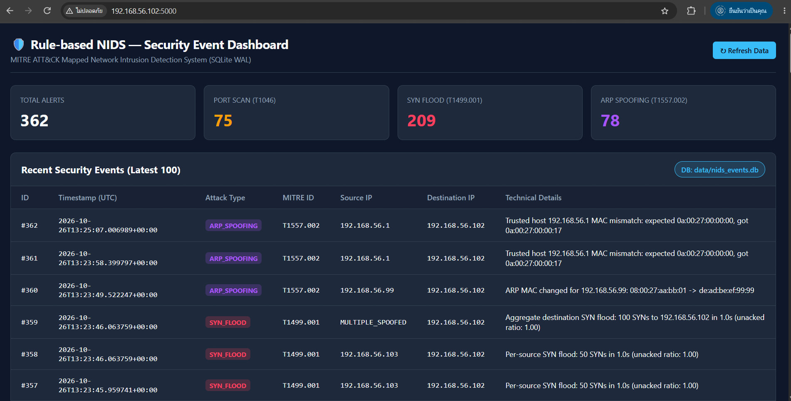
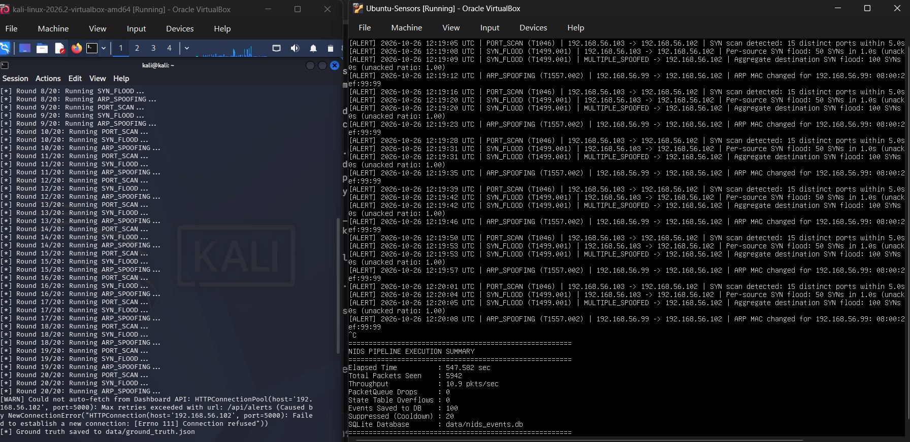
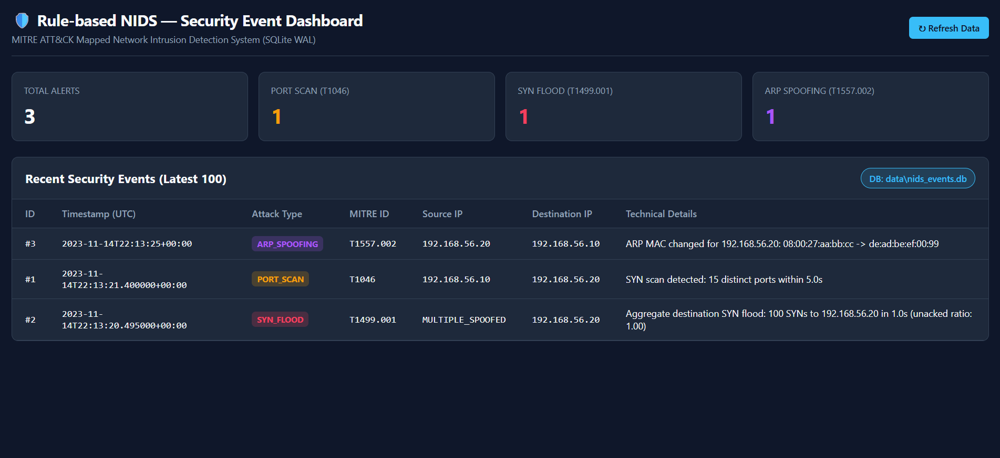

# 🛡️ Rule-Based Network Intrusion Detection System (NIDS)

ระบบตรวจจับการบุกรุกเครือข่ายแบบ Real-time พัฒนาด้วย **Python (Scapy)** บนสถาปัตยกรรม **Multi-threaded Double-Queue Pipeline** อ้างอิงรหัสภัยคุกคามตามมาตรฐาน **MITRE ATT&CK Framework** พร้อมฐานข้อมูล **SQLite (WAL Mode)**, ระบบแจ้งเตือน **Telegram Bot API** และหน้าเว็บ **Secured Flask SOC Dashboard**

> **Disclaimer**: โปรเจกต์นี้พัฒนาขึ้นเพื่อการศึกษาและทดสอบด้านวิศวกรรมความปลอดภัยในระบบเครือข่ายปิด (Isolated VirtualBox Host-Only Lab) เท่านั้น

---

## 1. System Demo & Screenshots

### Secured Flask SOC Dashboard (Real-time Alert Monitoring)


### Live Attack Simulation & Empirical Benchmark (Kali Linux vs. Ubuntu Sensor)


<details>
<summary>🔍 ดูภาพหน้าจอ Dashboard สถานะเริ่มต้น (Initial Baseline State)</summary>



</details>

---

## 2. System Architecture (Double-Queue Pipeline)

ออกแบบด้วยรูปแบบ **Producer–Consumer** แยก 3 Threads เพื่อลดผลกระทบของ Python GIL และป้องกันไม่ให้การเขียน Database หรือการส่ง HTTP Alert บล็อกการดักจับแพ็กเก็ต:

```text
[Network Interface (BPF: "tcp or arp", store=False)]
        │
        ▼
[1. Sniffer Thread] ──(put_nowait)──► [PacketQueue (maxsize=2000 + Drop Counter)]
                                                │
                                                ▼
[2. Analyzer Thread] ◄──(config.yaml)── [Logical Clock (pkt.time) & Bounded RAM State]
        │
        └──(put_nowait)──► [EventQueue (maxsize=500)]
                                    │
                                    ▼
[3. Worker Thread] ──► (1) Write-First to SQLite (WAL Mode: data/nids_events.db)
                   ──► (2) Cooldown Filter: Key = (src_ip, attack_type)
                   ──► (3) Telegram Bot API Alert (Timeout = 5.0s)

[Secured Flask Dashboard] ◄──(Concurrent Read via WAL)── [SQLite Database]
```

---

## 3. MITRE ATT&CK Mapping & Detection Rules

| Attack Technique | MITRE ATT&CK ID | Detection Mechanism |
| :--- | :--- | :--- |
| **TCP SYN Port Scan** | **T1046** (*Network Service Discovery*) | ตรวจจับจำนวน Destination Ports ที่ไม่ซ้ำกันจากแพ็กเก็ต `TCP SYN` (ไม่มี `ACK`) ต่อ 1 Source IP ภายใน Sliding Window (`5s`) เมื่อเกินเกณฑ์ (`15 ports`) |
| **TCP SYN Flood** | **T1499.001** (*OS Exhaustion Flood*) | ตรวจสอบอัตราส่วน `SYN` ที่ไม่มี `ACK` ตอบกลับ (`unacked_ratio >= 0.8`) ทั้งระดับ **Per-Source IP** (`>= 50 SYNs/s`) และ **Per-Destination Aggregate** (`>= 100 SYNs/s` เพื่อตรวจจับ `hping3 --rand-source`) |
| **ARP Cache Poisoning** | **T1557.002** (*ARP Cache Poisoning*) | ตรวจสอบแพ็กเก็ต `ARP Reply (op=2)` เทียบกับตาราง `Trusted Hosts Whitelist` และตาราง Baseline `IP -> MAC` ที่เรียนรู้ในช่วงเริ่มต้น (`Learning Phase`) แจ้งเตือนทันทีเมื่อเลข MAC เปลี่ยนแปลง |

---

## 4. Empirical Lab Benchmark Results

ผลการทดสอบจริงใน **VirtualBox Isolated Host-Only Lab** (`192.168.56.0/24`):
* **Attacker VM**: Kali Linux (`192.168.56.103`, 2 vCPU, 2 GB RAM) รันสคริปต์ `benchmark_lab.py` ทดสอบ Benign Traffic และยิงโจมตีจริงชนิดละ **20 รอบ**
* **Target & Sensor VM**: Ubuntu Server (`192.168.56.102`, 2 vCPU, 2 GB RAM, Interface `enp0s3`)

| Metric / Attack Type | MITRE ID | Detection Rate (20 Runs) | Avg Detection Latency | False Positives (Benign Session) |
| :--- | :--- | :--- | :--- | :--- |
| **Benign Traffic Baseline** (`ping`, normal `SYN`) | N/A | N/A | N/A | **0 alerts** (`10.4 s` session) |
| **TCP SYN Port Scan** (`nmap -sS -p 1-25`) | `T1046` | **20 / 20 (100%)** | **`2.164 s`** | 0 |
| **TCP SYN Flood** (`120 SYNs burst`) | `T1499.001` | **20 / 20 (100%)** | **`0.099 s`** | 0 |
| **ARP Cache Poisoning** (`Spoofed ARP Reply`) | `T1557.002` | **20 / 20 (100%)** | **`0.056 s`** | 0 |

---

## 5. Security Hardening & Engineering Highlights

* **Deterministic Logical Clock (`pkt.time`)**: คำนวณเวลาใน Sliding Window จาก Timestamp ของแพ็กเก็ตโดยตรง ทำให้สามารถทำ **Automated PCAP Replay Regression Testing** ด้วย `pytest` ใน CI Pipeline ได้ผลลัพธ์คงที่ 100%
* **Bounded In-Memory State Protection**: กำหนดเพดาน `max_state_entries: 10000` และมีระบบ Periodic Eviction กวาดล้างข้อมูลที่หมดอายุทุก 10 วินาที ป้องกันไม่ให้ตัว NIDS ถูกโจมตีแบบ Memory Exhaustion จากการสุ่ม IP (`--rand-source`)
* **Container Least Privilege**: รันผ่าน Docker โดยใช้ `cap_add: [NET_RAW, NET_ADMIN]` แทนการใช้ `privileged: true`
* **Authenticated SOC Dashboard**: ป้องกันการเข้าถึงหน้า Dashboard ด้วย HTTP Basic Auth ที่ตรวจสอบผ่าน `werkzeug.security` Password Hash และปิด `debug=False`
* **Automated DevSecOps Pipeline (CI/CD)**: บูรณาการ Static Security Analysis (Bandit), Regression Testing (Pytest), Container Scanning (Trivy) และส่งมอบ Image ขึ้น GHCR อัตโนมัติ

---

## 6. DevSecOps CI/CD Pipeline (`.github/workflows/CICD.yml`)

โปรเจกต์นี้มีระบบอัตโนมัติแบบครบวงจรผ่าน **GitHub Actions** เพื่อรับประกันคุณภาพซอฟต์แวร์และความปลอดภัยของ Container Image ก่อนนำไป Deploy ใช้งานจริง:

```mermaid
flowchart LR
    Push["Git Push / PR\n(main / master)"] --> CI["1. CI Stage\n(Test & SAST)"]
    
    subgraph Stage1["1. Continuous Integration (CI)"]
        SAST["SAST Scan\n(Bandit -r src/ -ll)"]
        PCAP["Synthetic PCAP Tests\n(Pytest 6/6 Passed)"]
    end

    CI --> SAST
    CI --> PCAP

    PCAP --> Gate{Push to main?}
    Gate -->|Yes| CD["2. CD Stage\n(Delivery to GHCR)"]
    Gate -->|No (PR)| Done["Complete (PR Check Passed)"]

    subgraph Stage2["2. Continuous Delivery (CD)"]
        DockerBuild["Docker Build\n(ghcr.io/repo:latest)"]
        Trivy["Container Scan\n(Trivy CRITICAL/HIGH)"]
        GHCR["Push to Registry\n(GitHub Container Registry)"]
        
        DockerBuild --> Trivy --> GHCR
    end

    CD --> DockerBuild
```

### รายละเอียดการทำงานของแต่ละ Stage:

#### 1. Continuous Integration (CI: `ci-test-and-sast`)
* **Trigger**: ทำงานทุกครั้งที่มีการ `push` หรือเปิด `pull_request` เข้าสู่กิ่ง `main` หรือ `master`
* **Static Application Security Testing (SAST)**:
  * ใช้ **Bandit** (`bandit -r src/ -ll`) ตรวจสอบความปลอดภัยของ Source Code ค้นหาช่องโหว่ความปลอดภัย เช่น Insecure Hash, Hardcoded Passwords, หรือ Unsanitized Calls
* **Synthetic PCAP Regression Testing**:
  * สังเคราะห์ไฟล์ PCAP 5 รูปแบบด้วย `scripts/generate_pcaps.py`
  * รัน `pytest -v` เพื่อทดสอบอัลกอริทึมการตรวจจับทั้ง 3 รูปแบบ (Port Scan, SYN Flood, ARP Spoofing) และตรวจสอบการควบคุมเพดานหน่วยความจำ (Memory Ceiling)

#### 2. Continuous Delivery (CD: `cd-build-and-publish`)
* **Trigger**: ทำงานอัตโนมัติเฉพาะเมื่อมีการ Merge หรือ `push` เข้าสู่ `main` / `master` (หลังจากผ่านขั้นตอน CI สำเร็จ 100%)
* **Automated Container Build**:
  * บิลด์ Docker Image สำหรับระบบตรวจจับ NIDS และ SOC Dashboard
* **Container Vulnerability Scanning (Trivy)**:
  * ใช้เครื่องมือ **Aqua Security Trivy** สแกนหาช่องโหว่ความปลอดภัยระดับ Base OS Packages และ Application Dependencies ใน Container Image
  * กำหนด Policy กรองช่องโหว่ระดับ `CRITICAL,HIGH` เพื่อบล็อกการเผยแพร่อิมเมจที่ไม่ปลอดภัย
* **Automated Package Registry Delivery (GHCR)**:
  * ทำการยืนยันตัวตนผ่าน `secrets.GITHUB_TOKEN` และ Push อิมเมจขึ้น **GitHub Container Registry (`ghcr.io`)** โดยอัตโนมัติ เพื่อให้เครื่อง Sensor หรือ Kubernetes Cluster ปลายทางสามารถ Pull ไป Deploy ต่อได้อย่างปลอดภัยและไร้รอยต่อ

---

## 7. Known Limitations & Threat Model Assumptions

1. **Low-and-Slow Port Scans**: การสแกนพอร์ตแบบหน่วงเวลาช้ามาก (เช่น `nmap -T0` หรือ `-T1` ที่ทิ้งระยะห่างเกินหน้าต่างเวลา `window_sec: 5`) สามารถหลบเลี่ยงเกณฑ์ Sliding Window ปัจจุบันได้
2. **ARP Learning Phase Assumption**: ช่วง `learning_duration_sec` ตอนเริ่มต้นระบบตั้งสมมติฐานว่าเครือข่ายยังไม่มีการปลอมแปลง ARP (สามารถป้องกันเพิ่มเติมได้ด้วยการกำหนด Static `trusted_hosts` สำหรับ Gateway และเครื่องสำคัญใน `config.yaml`)
3. **User-Space Packet Capture Ceiling**: เนื่องจาก Scapy ทำงานในระดับ Python User-space จึงเหมาะกับเครือข่ายขนาดเล็กถึงขนาดกลางหรือใช้เป็นต้นแบบ (Prototype) หากใช้งานระดับ Multi-Gigabit ควรใช้เอนจินระดับ Kernel/eBPF หรือ C/C++ (เช่น Suricata/Zeek)

---

## 8. Quick Start

### Run Unit & PCAP Regression Tests
```bash
pip install -r requirements.txt
python scripts/generate_pcaps.py
pytest -v
```

### Run Live Sensor & Secured Dashboard
```bash
# 1. Start Secured Dashboard (Accessible at http://<SENSOR_IP>:5000)
python3 src/dashboard.py --host 0.0.0.0 --port 5000

# 2. Start Live Packet Sniffer (Requires root / NET_RAW capability)
sudo ./venv/bin/python3 src/sniffer.py --iface enp0s3
```

### Run with Docker Compose (Linux Host)
```bash
docker compose up --build -d
```

---

## 9. Full Documentation Guides

* 📖 **[คู่มือการติดตั้งและการรันแล็บ (Lab Setup & Deployment Guide)](docs/setup.md)**: ขั้นตอนการตั้งค่า VM, การเปิด venv, การใช้สิทธิ์ Root, และการรันสคริปต์ Benchmark บน Kali Linux
* 🧠 **[คู่มือสถาปัตยกรรมและการทำงานของโค้ด (Understanding Code & Architecture)](docs/understanding%20code.md)**: เจาะลึกอัลกอริทึมการตรวจจับ, การทำงานของ Double-Queue Pipeline, การจัดการ Memory และไฟล์ Config


---

## 9. Full Documentation Guides

* 📖 **[คู่มือการติดตั้งและการรันแล็บ (Lab Setup & Deployment Guide)](docs/setup.md)**: ขั้นตอนการตั้งค่า VM, การเปิด venv, การใช้สิทธิ์ Root, และการรันสคริปต์ Benchmark บน Kali Linux
* 🧠 **[คู่มือสถาปัตยกรรมและการทำงานของโค้ด (Understanding Code & Architecture)](docs/understanding%20code.md)**: เจาะลึกอัลกอริทึมการตรวจจับ, การทำงานของ Double-Queue Pipeline, การจัดการ Memory และไฟล์ Config
```
