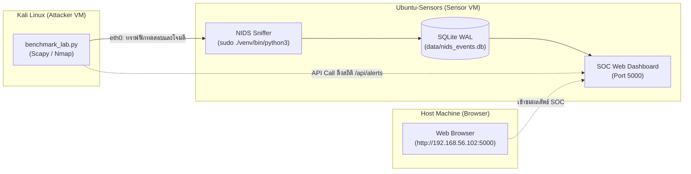

# คู่มือการติดตั้งและทดสอบระบบ NIDS ในสภาพแวดล้อม Lab (Setup & Deployment Guide)

เอกสารขั้นตอนการติดตั้ง (Setup), การตั้งค่าเครือข่าย และขั้นตอนการรันระบบ **NIDS (Network Intrusion Detection System)** ระหว่างเครื่องตรวจจับ (Sensor) และเครื่องทดสอบโจมตี (Attacker) ใน VirtualBox

---

## 1. ภาพรวมสถาปัตยกรรมแล็บ (Lab Topology)

การทดสอบแบ่งออกเป็น 2 เครื่องเสมือน (Virtual Machines) ที่เชื่อมต่อกันผ่านเครือข่ายแบบ **Host-Only Network** (`192.168.56.0/24`):



### ข้อมูลเครื่องเสมือน (VM Credentials & Roles)

| เครื่อง VM | บทบาท | IP Address | Network Interface | Username | Password |
| :--- | :--- | :--- | :--- | :--- | :--- |
| **Ubuntu-Sensors** | Sensor & Web Dashboard | `192.168.56.102` | `enp0s3` | `vboxuser` | `ubuntu` |
| **Kali Linux** | Attacker / Benchmark Runner | `192.168.56.x` | `eth0` | `kali` | `kali` |

---

## 2. ขั้นตอนการ Setup ฝั่ง Ubuntu-Sensors (เครื่องตรวจจับ)

### 2.1 ติดตั้ง System Packages ที่จำเป็น
เปิด Terminal บน Ubuntu-Sensors แล้วรันคำสั่งอัปเดตระบบและติดตั้งแพ็กเกจพื้นฐาน:

```bash
sudo apt update
sudo apt install -y python3 python3-pip python3-venv git libpcap-dev
```

### 2.2 เข้าโฟลเดอร์โปรเจกต์และสร้าง Virtual Environment (venv)

```bash
# 1. เข้าสู่โฟลเดอร์โปรเจกต์
cd ~/nids-project

# 2. สร้างสภาพแวดล้อมจำลอง (venv)
python3 -m venv venv

# 3. เปิดใช้งาน venv
source venv/bin/activate
```

> [!TIP]
> เมื่อเปิดใช้งาน venv สำเร็จ จะสังเกตเห็นข้อความ `(venv)` ขึ้นนำหน้าบรรทัดคำสั่งใน Terminal

### 2.3 ติดตั้ง Python Dependencies
ติดตั้งไลบรารีที่ NIDS จำเป็นต้องใช้:

```bash
pip install --upgrade pip
pip install -r requirements.txt
```

*(หรือติดตั้งแบบระบุแพ็กเกจตรง: `pip install scapy pyyaml flask requests pytest`)*

### 2.4 ตรวจสอบความถูกต้องด้วย Unit Tests
รันชุดทดสอบเพื่อยืนยันว่าอัลกอริทึมการตรวจจับทำงานถูกต้องครบถ้วน:

```bash
pytest -v
```

---

## 3. ขั้นตอนการ Setup ฝั่ง Kali Linux (เครื่องโจมตี)

### 3.1 ติดตั้งเครื่องมือและไลบรารีทดสอบบน Kali
เปิด Terminal บนเครื่อง Kali Linux แล้วรัน:

```bash
sudo apt update
sudo apt install -y python3 python3-pip python3-scapy python3-requests nmap
```

### 3.2 คัดลอกสคริปต์ `benchmark_lab.py` ไปยังเครื่อง Kali
คัดลอกไฟล์ `scripts/benchmark_lab.py` จากโปรเจกต์มาไว้ที่โฟลเดอร์ Home (`~/benchmark_lab.py`) ของ Kali เช่น ใช้คำสั่ง `scp` จากโฮสต์ หรือแชร์ผ่าน Shared Folder:

```bash
# ตัวอย่างการส่งผ่าน SCP จากเครื่อง Sensor ไปยัง Kali (รันบน Ubuntu หรือ Host)
scp ~/nids-project/scripts/benchmark_lab.py kali@192.168.56.x:~/benchmark_lab.py
```

### 3.3 ตรวจสอบการเชื่อมต่อเครือข่าย
ทดสอบยิง Ping จาก Kali ไปยังเครื่อง Ubuntu-Sensors:

```bash
ping -c 3 192.168.56.102
```

---

## 4. ขั้นตอนการรันระบบและทดสอบ Live Benchmark

เพื่อให้ระบบทำงานประสานกันครบวงจร ให้เปิด Terminal ตามขั้นตอนดังนี้:

### ขั้นตอนที่ 1: รัน NIDS Sniffer บน Ubuntu-Sensors

เปิด Terminal ที่ 1 บน Ubuntu-Sensors:

```bash
cd ~/nids-project
source venv/bin/activate
sudo ./venv/bin/python3 src/sniffer.py --iface enp0s3
```

> [!IMPORTANT]
> **ทำไมต้องใช้ `sudo ./venv/bin/python3`?**
> 1. **สิทธิ์ Root (`sudo`)**: Scapy จำเป็นต้องใช้สิทธิ์ Raw Sockets (`CAP_NET_RAW`) ในการดักฟังและจับแพ็กเก็ตจาก Network Interface (`enp0s3`)
> 2. **ใช้ Python ของ venv (`./venv/bin/python3`)**: ป้องกันปัญหาของคำสั่ง `sudo` ทั่วไปที่จะรีเซ็ต PATH กลับไปหา System Python (`/usr/bin/python3`) ซึ่งไม่มีแพ็กเกจ `scapy` ทำให้เกิดข้อผิดพลาด `ModuleNotFoundError`

เมื่อรันสำเร็จ หน้าจอจะแสดงสถานะเริ่มตรวจจับ:
```text
[*] NIDS Engine Initializing...
[*] Sniffer listening on enp0s3 (BPF: tcp or arp)
[*] Pipeline active: Sniffer -> PacketQueue -> Analyzer -> EventQueue -> AlertWorker
```

---

### ขั้นตอนที่ 2: รัน SOC Web Dashboard บน Ubuntu-Sensors (เปิดอีก Terminal)

เปิด Terminal ที่ 2 บน Ubuntu-Sensors เพื่อรันหน้าเว็บมอนิเตอร์:

```bash
cd ~/nids-project
source venv/bin/activate
python3 src/dashboard.py --host 0.0.0.0 --port 5000
```

* สามารถเปิดดูหน้าจอ SOC Dashboard ได้จากเบราว์เซอร์ของเครื่อง Host: [http://192.168.56.102:5000](http://192.168.56.102:5000)
* **Username**: `admin`
* **Password**: `nids2026`

---

### ขั้นตอนที่ 3: รันสคริปต์ Benchmark การโจมตีบน Kali Linux

เปิด Terminal บน Kali Linux แล้วรันการยิงทดสอบระบบ:

```bash
sudo python3 ~/benchmark_lab.py --target 192.168.56.102 --iface eth0 --rounds 20 --interval 3
```

#### คำอธิบายพารามิเตอร์ของคำสั่ง:
* `sudo`: จำเป็นต้องใช้สิทธิ์ Root เพื่อส่ง Raw Packets และกำหนดเลข MAC Address ปลอม
* `--target 192.168.56.102`: ระบุ IP ปลายทางของเครื่อง Sensor
* `--iface eth0`: ระบุการ์ดแลนฝั่งเครื่อง Kali ที่ใช้ส่งแพ็กเก็ต
* `--rounds 20`: จำนวนรอบที่ยิงทดสอบแต่ละรูปแบบการโจมตี (รอบละ 3 เทคนิค)
* `--interval 3`: เวลารอ (วินาที) ในการส่งแพ็กเก็ตแต่ละระลอก

#### รูปแบบการโจมตีที่สคริปต์ทดสอบอัตโนมัติ:
1. **Benign Traffic Session**: ส่ง Ping ปกติและทราฟฟิกเชื่อมต่อทั่วไป เพื่อวัดผล **False Positive**
2. **Port Scan (T1046)**: ยิง TCP SYN Scan ไปยังพอร์ตเป้าหมาย 25 พอร์ต
3. **SYN Flood (T1499.001)**: ยิง TCP SYN Flood จำนวน 120 แพ็กเก็ตในเสี้ยววินาที
4. **ARP Spoofing (T1557.002)**: ส่ง ARP Reply ปลอมแปลงเลข MAC Address เพื่อหลอกตาราง ARP Cache

---

## 5. การดูผลลัพธ์การประเมิน (Evaluation & Verification)

หลังจากสคริปต์ `benchmark_lab.py` ทำงานครบ 20 รอบ สคริปต์จะดึงข้อมูลผ่าน API `/api/alerts` ของ Dashboard มาเปรียบเทียบกับ Ground Truth โดยอัตโนมัติ และแสดงผลลัพธ์ดังนี้:

```text
=================================================================
EMPIRICAL BENCHMARK RESULTS (READY FOR README.MD)
=================================================================
Benign Traffic False Alerts : 0 alerts (Duration: 10.0s)
-----------------------------------------------------------------
| Attack Type | MITRE ID | Detection Rate | Avg Detection Latency |
| :--- | :--- | :--- | :--- |
| PORT_SCAN | T1046 | 20/20 | 0.042 s |
| SYN_FLOOD | T1499.001 | 20/20 | 0.015 s |
| ARP_SPOOFING | T1557.002 | 20/20 | 0.008 s |
=================================================================
```

ภาพหน้าจอ Dashboard แสดงรายการเหตุการณ์การโจมตีที่ตรวจจับได้จริงแบบ Real-time:


---

## 6. ข้อควรระวังและแนวทางแก้ไขปัญหา (Troubleshooting)

### 1. ยิงทดสอบแล้ว Alert ไม่ขึ้นครบตามจำนวนรอบ (Cooldown Suppression)
* ใน `config.yaml` มีค่า `cooldown_sec: 300` ซึ่งป้องกันไม่ให้ส่ง Alert ซ้ำจาก IP และประเภทการโจมตีเดิมภายใน 5 นาที
* หากต้องการทดสอบ Benchmark ต่อเนื่อง ให้ปรับค่าใน `config.yaml` บนเครื่อง Sensor ชั่วคราว:
  ```yaml
  alerting:
    cooldown_sec: 1    # ลดเหลือ 1 วินาที เพื่อให้บันทึกทุกรอบการทดสอบ
  ```

### 2. Interface ไม่ตรง (`enp0s3` vs `eth0`)
* ตรวจสอบชื่อ Interface จริงของเครื่องด้วยคำสั่ง:
  ```bash
  ip link show
  # หรือ
  ip a
  ```
* หากชื่อ Interface ของ Ubuntu ไม่ใช่ `enp0s3` ให้เปลี่ยนพารามิเตอร์ `--iface <ชื่อจริง>` ตอนรัน `sniffer.py`

### 3. เข้าหน้า Dashboard ไม่ได้จากเครื่อง Host
* ตรวจสอบว่า Firewall บน Ubuntu ปิดอยู่ หรือเปิดพอร์ต 5000:
  ```bash
  sudo ufw allow 5000/tcp
  ```
* ตรวจสอบว่า `src/dashboard.py` รันด้วย `--host 0.0.0.0` (หากรันเป็น `127.0.0.1` จะเข้าได้เฉพาะภายในเครื่องตัวเองเท่านั้น)

