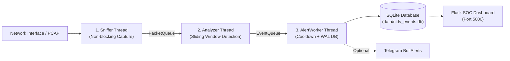

# คู่มือทำความเข้าใจระบบ NIDS (Architecture & Code Cheatsheet)

เอกสารสรุปสถาปัตยกรรม การทำงานของโค้ดแต่ละโมดูล และแนวทางการทดสอบระบบ **Network Intrusion Detection System (NIDS)**

---

## 1. ภาพรวมสถาปัตยกรรมระบบ (System Architecture)

ระบบทำงานแบบ **3-Thread Double-Queue Pipeline** เพื่อแยกภาระงานและรับประกันว่าการดักจับแพ็กเก็ตจะไม่ถูกขัดจังหวะจากงานวิเคราะห์หรือการแจ้งเตือน



---

## 2. การตั้งค่าใน `config.yaml`

ไฟล์กำหนดค่าหลักของระบบ มีจุดสำคัญที่ต้องทำความเข้าใจดังนี้:

### 2.1 SYN Flood Thresholds (`src_syn_threshold` vs `dst_syn_threshold`)
* **`src_syn_threshold: 50` (ครั้ง/วินาที)**:
  * ใช้ดักจับเมื่อแฮกเกอร์ยิงโจมตีมาจาก **IP เดียว** เกิน 50 SYN ต่อวินาที
* **`dst_syn_threshold: 100` (ครั้ง/วินาที)**:
  * ใช้ดักจับเมื่อแฮกเกอร์ **สุ่ม IP ปลอมทุกแพ็กเก็ต** (เช่น คำสั่ง `hping3 --rand-source`)
  * ตรวจจับจากผลรวม SYN ทั้งหมดที่พุ่งเข้าหา IP ปลายทางเดียวกันเกิน 100 ครั้งต่อวินาที

### 2.2 ป้องกัน Memory Exhaustion (`max_state_entries`)
* **`max_state_entries: 10000`**:
  * เกราะป้องกันไม่ให้ผู้โจมตียิงสุ่ม IP เข้ามาเรื่อยๆ จนตาราง State Dictionary ใน Python ขยายตัวไม่หยุดจน RAM เครื่องเต็ม
  * หากเกินจำนวนนี้ ระบบจะนับ `state_overflow_count` และล้างข้อมูลเก่าที่หมดอายุอัตโนมัติ

---

## 3. การสังเคราะห์ชุดทดสอบด้วย `scripts/generate_pcaps.py`

สคริปต์นี้สร้างไฟล์ Packet Capture (.pcap) จำลองสถานการณ์ต่างๆ เพื่อใช้ทดสอบระบบโดยไม่ต้องพึ่งพาเครือข่ายภายนอก

### 3.1 กลไก Logical Clock (`pkt.time`)
* กำหนดเวลาใน Header ของทุกแพ็กเก็ตแบบเจาะจง (`BASE_TIME + offset`)
* ทำให้การทดสอบ **Sliding Window** ได้ผลลัพธ์ที่แน่นอน (Deterministic) และแม่นยำ 100% ทุกครั้ง ไม่ว่าจะรันบนเครื่องที่ช้าหรือเร็ว

### 3.2 รายละเอียดไฟล์ PCAP ทั้ง 5 รูปแบบ (`tests/fixtures/`)

| ลำดับ | ไฟล์ PCAP | รายละเอียดพฤติกรรม | ผลลัพธ์ที่คาดหวัง |
| :--- | :--- | :--- | :--- |
| 1 | `benign.pcap` | ทราฟฟิก ARP และ TCP 3-Way Handshake ปกติ | **False Positive = 0** (ต้องไม่แจ้งเตือน) |
| 2 | `port_scan.pcap` | ยิง TCP SYN ไป 20 พอร์ตที่ไม่ซ้ำกันใน 2 วินาที | แจ้งเตือน Port Scan (เกินเพดาน 15 พอร์ต) |
| 3 | `syn_flood_single.pcap` | ยิง 60 SYN packets จาก IP เดียวภายใน 0.6 วินาที (ไม่มี ACK) | แจ้งเตือน SYN Flood (Per-Source) |
| 4 | `syn_flood_rand.pcap` | ยิง 120 SYN packets สุ่ม Source IP (`--rand-source`) ภายใน 0.6 วินาที | แจ้งเตือน SYN Flood (Per-Destination) |
| 5 | `arp_spoof.pcap` | ส่ง ARP ปกติที่ $t=0$s และส่ง ARP ปลอมเปลี่ยนเลข MAC ของ IP เดิมที่ $t=5$s | แจ้งเตือน ARP Spoofing |

### 3.3 คำสั่งรันสร้างไฟล์ .pcap

```powershell
python scripts/generate_pcaps.py
```

---

## 4. กลไกตรวจจับใน `src/analyzer.py`

* **`src/analyzer.py`**: สมองกลตรวจจับภัยคุกคามหลัก (`NIDSAnalyzer`)
* **`tests/test_analyzer.py`**: ชุดทดสอบอัตโนมัติผ่าน `pytest`

### 4.1 การตรวจจับครบ 3 เทคนิคตาม MITRE ATT&CK

* **ARP Spoofing (`T1557.002`)**:
  * ตรวจสอบ Whitelist จาก `trusted_hosts`
  * มีช่วงเวลาเรียนรู้เริ่มต้น (`learning_duration_sec`)
  * ตรวจจับการเปลี่ยนเลข MAC อย่างกะทันหันของ IP เดิม
* **Port Scan (`T1046`)**:
  * ติดตามแพ็กเก็ต TCP SYN และนับจำนวน Destination Port ที่ไม่ซ้ำกันภายในหน้าต่างเวลา 5 วินาที
* **SYN Flood (`T1499.001`)**:
  * ตรวจสอบอัตราส่วน SYN ที่ไม่ได้รับ ACK (`min_unacked_ratio: 0.8`)
  * ตรวจสอบ 2 มิติ: ระดับ Per-Source IP และ Per-Destination IP (ป้องกันการสุ่ม Source IP)

### 4.2 การจัดการหน่วยความจำ (Memory Protection)
* จำกัดจำนวน Entry สูงสุดใน RAM ด้วย `max_state_entries`
* มีระบบนับ `state_overflow_count` และฟังก์ชัน `_cleanup_expired_states()` คอยกวาดล้างข้อมูลหมดอายุ

### 4.3 คำสั่งรันทดสอบชุดตรวจจับ (Unit Tests)

```powershell
pytest -v
```

---

## 5. การทำงานของ `src/sniffer.py` และ `src/worker.py`

### 5.1 จุดเด่นของการออกแบบ Pipeline
* **3-Thread Double-Queue Architecture**:
  * `Sniffer` $\rightarrow$ `PacketQueue` $\rightarrow$ `Analyzer` $\rightarrow$ `EventQueue` $\rightarrow$ `AlertWorker`
* **Non-blocking Packet Capture**:
  * ใช้ `packet_queue.put_nowait(pkt)` ใน Callback ของ Sniffer
  * หากคิวเต็มจะนับจำนวน PacketQueue Drops ทันที เพื่อไม่ให้กระทบการดักจับแพ็กเก็ตถัดไป
* **SQLite Write-First Priority**:
  * บันทึกทุก Event ลงฐานข้อมูล `data/nids_events.db` พร้อมเปิดโหมด `PRAGMA journal_mode=WAL;`
  * บันทึกลงฐานข้อมูลเสร็จก่อนส่ง Telegram เสมอ เพื่อป้องกัน Alert ตกหล่นกรณีเน็ตขัดข้อง
* **Alert Cooldown System**:
  * ใช้คีย์ `(src_ip, attack_type)` ระงับการแจ้งเตือนซ้ำจาก IP และรูปแบบการโจมตีเดิมเป็นเวลา 300 วินาที
  * พร้อมนับสถิติ Suppressed Alerts
* **รองรับ 2 โหมดการทำงาน**:
  * โหมด `--pcap`: ใช้ทดสอบ Pipeline ทั้งระบบกับไฟล์ตัวอย่างบนเครื่องโฮสต์ได้ทันที
  * โหมด `--iface`: ใช้ดักจับทราฟฟิกจริงจากเน็ตเวิร์กการ์ด (เช่น บน Sensor VM)

### 5.2 วิธีรันทดสอบ Pipeline ด้วยไฟล์ .pcap

รันคำสั่งเหล่านี้เพื่อทดสอบการสื่อสารข้าม 3 Threads และตรวจสอบการบันทึกข้อมูลลง SQLite:

```powershell
python src/sniffer.py --pcap tests/fixtures/port_scan.pcap
python src/sniffer.py --pcap tests/fixtures/syn_flood_rand.pcap
python src/sniffer.py --pcap tests/fixtures/arp_spoof.pcap
```

> [!NOTE]
> เมื่อรันเสร็จจะแสดงตารางสรุป `NIDS PIPELINE EXECUTION SUMMARY` บนหน้าจอ พร้อมสร้างฐานข้อมูล `data/nids_events.db` โดยอัตโนมัติ

### 5.3 (ทางเลือก) การผูกแจ้งเตือนผ่าน Telegram

หากต้องการให้ระบบส่ง Alert เข้าสมาร์ตโฟน:

1. ค้นหา `@BotFather` ใน Telegram $\rightarrow$ ส่งคำสั่ง `/newbot` ตั้งชื่อและรับ **Bot Token**
2. ค้นหา `@userinfobot` ใน Telegram $\rightarrow$ กด **Start** เพื่อดู **Chat ID** ของตัวเอง
3. ทักแชทบอทที่สร้างขึ้น แล้วกด **Start** หนึ่งครั้ง
4. กำหนด Environment Variables ใน PowerShell:

```powershell
$env:TELEGRAM_BOT_TOKEN="ใส่_Token_ตรงนี้"
$env:TELEGRAM_CHAT_ID="ใส่_Chat_ID_ตรงนี้"
```

5. เปิดการใช้งานใน `config.yaml`:

```yaml
alerting:
  telegram:
    enabled: true
```

---

## 6. เว็บมอนิเตอร์ SOC Dashboard (`src/dashboard.py`)

เว็บแสดงผล Dashboard แบบ Single-File สำหรับมอนิเตอร์เหตุการณ์ด้านความปลอดภัยแบบ Real-time

### 6.1 คุณสมบัติสำคัญ
* **Password Hash Authentication**: ล็อกอินผ่าน HTTP Basic Auth ตรวจสอบรหัสผ่านด้วย `werkzeug.security.check_password_hash` (ไม่เก็บ Plaintext ใน Memory)
* **Security Hardened**: ปิด `debug=False` เป็นค่าเริ่มต้น และจำกัดการ Bind IP (`127.0.0.1` สำหรับ Localhost หรือ IP วง `192.168.56.x` บน VM)
* **Single-File SOC UI & REST API**:
  * แสดงการ์ดสรุปยอดแจ้งเตือนตามรหัส MITRE ATT&CK (`T1046`, `T1499.001`, `T1557.002`)
  * แสดงตาราง 100 เหตุการณ์ล่าสุด
  * มี Endpoint `/api/alerts` สำหรับดึงข้อมูลรูปแบบ JSON

### 6.2 ขั้นตอนการติดตั้งและรัน Dashboard

1. ติดตั้งแพ็กเกจ Flask:

```powershell
pip install flask
```

2. เริ่มการทำงานของเซิร์ฟเวอร์ Dashboard:

```powershell
python src/dashboard.py
```

3. เข้าใช้งานผ่านเว็บเบราว์เซอร์: [http://127.0.0.1:5000](http://127.0.0.1:5000)

* **Username เริ่มต้น**: `admin`
* **Password เริ่มต้น**: `nids2026` *(เปลี่ยนได้ผ่าน Environment Variable `NIDS_ADMIN_PASS`)*

### 6.3 ภาพตัวอย่างหน้าจอ Dashboard


---

## 7. ข้อมูลการเข้าสู่ระบบ VM Lab (VirtualBox)

ข้อมูลบัญชีผู้ใช้งานสำหรับเครื่องเสมือนในสภาพแวดล้อมทดสอบแล็บ:

| เครื่อง Virtual Machine | บัญชีผู้ใช้ (Username) | รหัสผ่าน (Password) | บทบาทหน้าที่ในระบบทดสอบ |
| :--- | :--- | :--- | :--- |
| **Ubuntu-Sensors** | `vboxuser` | `ubuntu` | รันตัวตรวจจับ NIDS Engine ดักฟังทราฟฟิกในเครือข่าย |
| **Kali Linux** | `kali` | `kali` | เครื่องผู้โจมตี (Attacker) สำหรับยิงทดสอบเครื่องมือเจาะระบบ |

> [!TIP]
> สำหรับขั้นตอนการติดตั้ง Dependencies, การเปิดใช้งาน venv, การรัน Sniffer ด้วยสิทธิ์ Root และการยิงทดสอบ Live Benchmark จาก Kali สามารถอ่านคู่มือฉบับเต็มได้ที่ [doc/setup.md](setup.md)

